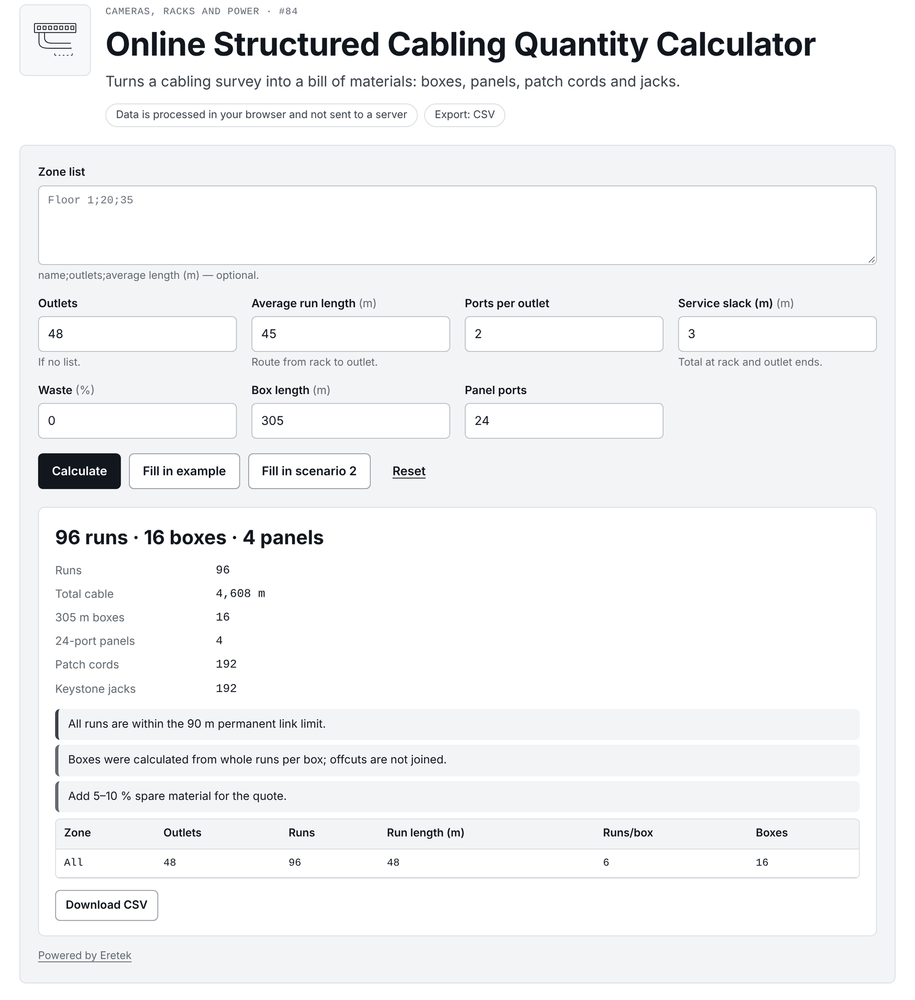

# Structured Cabling Quantity Calculator

Calculate total cable length, number of 305 m boxes (whole runs per box), patch panels and patch cords from outlet count, average run length and service slack.

## Try it live

- [Türkçe](https://kamera.eretek.com/araclar/kablolama-metraj-hesaplama)
- [English](https://kamera.eretek.com/en/tools/cabling-quantity-calculator)
- [Deutsch](https://kamera.eretek.com/de/werkzeuge/verkabelung-mengenrechner)



## What it does

Turns a cabling survey into a bill of materials: boxes, panels, patch cords and jacks.

Dividing total metres by box length forgets the offcuts at the end of each box that cannot be joined, so cable runs short on site. The tool calculates how many whole runs each box yields, checks the 90 m permanent link limit and gives panel and patch cord counts.

## Where it helps

Add 5–10 % spare for the quote; plan an intermediate rack or fibre for long runs. Use the Rack Unit planner for the rack layout.

## How to use it

1. Enter either total outlets and average length, or a zone list as `name;outlets;average m`.
2. Enter ports per outlet, service slack, waste, box length and panel port count.
3. Press Run; download the list as CSV.

### Fields

| Field | Description |
|---|---|
| Zone list | name;outlets;average length (m) — optional. |
| Outlets | If no list. |
| Average run length | Route from rack to outlet. |
| Ports per outlet |  |
| Service slack (m) | Total at rack and outlet ends. |
| Waste |  |
| Box length |  |
| Panel ports |  |

## Example input

Press **Fill in example** in the tool to load this input.

| Input | Value |
|---|---|
| Outlets | `48` |
| Average run length | `45` |
| Ports per outlet | `2` |
| Service slack (m) | `3` |
| Box length | `305` |
| Panel ports | `24` |

**Expected result:** 48 outlets × 2 ports = 96 runs of 48 m; 6 runs per box → 16 boxes (4,608 m), four 24-port panels, 192 patch cords, 192 jacks.

## Method and assumptions

Runs = outlets × ports. Run length = average + slack. Runs per box = floor(box / (run length × (1 + waste))). Boxes = ceil(runs / runs per box). Panels = ceil(runs / panel ports). Patch cords = runs × 2 (rack + user side), jacks = runs × 2.

## Limits and common mistakes

- Averages replace route measurement; risers, ceiling/floor penetrations and containment fill must be calculated separately.

## Run it locally

The tool is plain HTML, CSS and JavaScript with no build step and no dependencies.

```bash
git clone https://github.com/eretek/cabling-quantity-calculator.git
cd cabling-quantity-calculator
node scripts/serve.js        # or: python3 -m http.server 8080
```

Open <http://127.0.0.1:8080/>. Add `?lang=tr` or `?lang=de` for Turkish or German; without it the page follows the browser language and falls back to English. You can also open `index.html` directly from disk.

Run the tests (Node.js 18 or later):

```bash
node test/run.js    # or: npm test
```

The tests run the tool's own fixtures and the worked examples in all three languages without a browser.

## How it works

All processing happens in your browser. The tool makes no network requests, uses no cookies or browser storage, and does not upload files you select.

No server-side component is needed. The version on the Eretek website renders the same page through a private WordPress plugin; that plugin only produces the page markup and is not part of this repository.

| Path | Purpose |
|---|---|
| `index.html` | Page shell |
| `src/app.js` | Builds the page in Turkish, English or German from `src/data.js` |
| `src/data.js` | Field definitions, examples and all texts in three languages |
| `src/core.js` | Shared runtime: validation, number formats, result rendering, CSV/ICS export |
| `src/tool.js` | The calculation or analysis for this tool |
| `docs/screenshot.png` | Screenshot used in this README |
| `src/tools.css`, `src/page.css` | Styles |
| `test/run.js`, `test/cases.json` | Headless tests |

## License and attribution

This tool is released under the [Eretek Website Attribution License](LICENSE). You may use, modify and redistribute it, including commercially. If you make it available on a website or web application, show a visible, clickable credit linking to https://eretek.com/ on every page where the tool is available, for example:

```html
<a href="https://eretek.com/">Powered by Eretek</a>
```

You may add `rel="nofollow"` to the link. Keep the copyright notice and license text in copies and redistributions.
